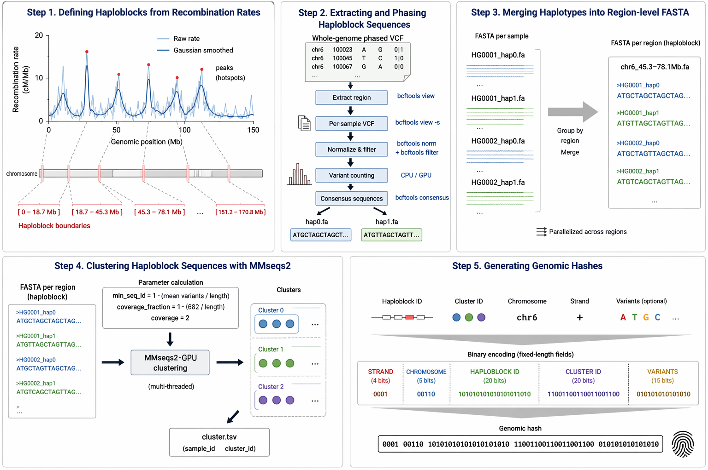

# Genomic Cluster Engine

This pipeline generates recombination-defined genomic hashes, unique identifiers that contain haplotype-resolved variant information. Every hash is a unique representation of an individual's genotype with a distinct combination of variants segragated across haploblocks. We also provide an example model for a hash-based genotype-to-phenotype mapping.

#### Pipeline overview




# How to use this repo

```
git clone https://github.com/collaborativebioinformatics/Genomic_Cluster_Engine.git
cd Genomic_Cluster_Engine/
```

# Run the pipeline

To create genomic hashes you can run the pipeline using Docker or step-by-step, as described below:


## Use Docker

Build the Docker image (example data will be automatically downloaded into `data/` inside the container):
```
docker build -t haploblock-pipeline .
```

Run the Docker container interactively:
```
docker run -it --rm \
    -v host_mount_point/data:/app/Genomic_Cluster_Engine/data \
    haploblock-pipeline
```

Once inside the container, the pipeline can be run with:
```
cd haploblock_pipeline
python3 main.py --config config/default.yaml [optional arguments]
```

The default config file is in [config/default.yaml](haploblock_pipeline/config/default.yaml). It defines input paths, pipeline settings, and parallelization parameters.

Optional arguments:
```
--threads <N> : Number of threads to use (default: available CPUs minus 1)
--step <1|2|3|4|5|all> : Execute only a specific pipeline step (default: 'all')
```

## GPU Acceleration for Hashing

By default, GPU acceleration is disabled (`gpu: false`).

To enable GPU acceleration for hashing, you must modify the pipeline configuration [config/default.yaml](haploblock_pipeline/config/default.yaml).

### Steps

1. Enter the running container.
2. Open the pipeline configuration file.
3. Set the `--gpu` flag to `true`.

### Example Configuration

```
pipeline:
  step: all           # Options: 1, 2, 3, 4, 5, or "all"
  threads: auto       # Number of threads (auto = CPU count - 1)
  gpu: true           # Enable or disable GPU usage
  gpu_id: 0           # Optional GPU index
```


The pipeline can be also run in the non-interactive mode:
```
docker run --rm \
    -v host_mount_point/data:/app/Genomic_Cluster_Engine/data \
    -v host_mount_point/config/default.yaml:/app/Genomic_Cluster_Engine/config/default.yaml \
    haploblock-pipeline \
    python3 main.py --config config/default.yaml
```


## Run the pipeline step-by-step


### Configure Python environment and install dependencies

For Python dependencies see [requirements.txt](requirements.txt). For other dependencies and how to install them see [install_dependencies.md](install_dependencies.md). Follow the instructions *carefully*: the pipeline requires samtools, bcftools, htslib (see https://www.htslib.org/) and MMseqs2 (https://github.com/soedinglab/MMseqs2), all must be simlinked in `/usr/bin` or exported to PATH.


### Data

All data listed below must be downloaded into `data/`:

```
cd data/
```

1. Recombination map from Halldorsson et al. 2019 with empirically defined genome-wide recombination rates:
```
## Download https://www.science.org/doi/suppl/10.1126/science.aau1043/suppl_file/aau1043_datas3.gz
## Upload the file to the data/ directory
gzip -d aau1043_datas3.gz
```

File `aau1043_datas3` contains averaged maternal and paternal recombination rates.

2. 1000Genomes, HGSVC, Phase 3

For the example, we use all populations (2548 samples) and chromosome 6. If you would like to run all chromosomes, download also phased VCF files for other chromosomes.

Phased VCF file for chromosome 6:
```
wget https://ftp.1000genomes.ebi.ac.uk/vol1/ftp/data_collections/1000_genomes_project/release/20190312_biallelic_SNV_and_INDEL/ALL.chr6.shapeit2_integrated_snvindels_v2a_27022019.GRCh38.phased.vcf.gz
```

and index file (same point as about chromosomes):
```
wget https://ftp.1000genomes.ebi.ac.uk/vol1/ftp/data_collections/1000_genomes_project/release/20190312_biallelic_SNV_and_INDEL/ALL.chr6.shapeit2_integrated_snvindels_v2a_27022019.GRCh38.phased.vcf.gz.tbi
```

3. Reference sequence for chromosome 6 (GRCh38), must be bgzipped:
```
wget https://hgdownload.soe.ucsc.edu/goldenPath/hg38/chromosomes/chr6.fa.gz
gzip -d chr6.fa.gz
## If you do not have bgzip, install it (see install_dependencies.txt)
bgzip chr6.fa
```

Optionally for testing, if you want to run the pipeline for one only population from 1000Genomes, you will also need a TSV file with the list of samples downloaded in data/, e.g. CHB can be downloaded from: https://www.internationalgenome.org/data-portal/population/CHB


#### 1. Generate haploblock boundaries:

```
python3 haploblock_pipeline/step1_haploblocks.py \
    --recombination_file data/Halldorsson2019/aau1043_datas3 \
    --chr 6 \
    --out out_dir/
```

This step creates:
- **haploblock boundaries**: TSV file with header and 2 columns (START END)

For a detailed description of how haplobock boundaries are defined see [https://github.com/jedrzejkubica/Elixir-BH-2025](https://github.com/jedrzejkubica/Elixir-BH-2025) as well as Halldorsson et al. 2019.


#### 2. Generate haploblock phased sequences:

This step generates a phased FASTA file for each individual and each haploblock by extracting sequence segments defined by the haploblock boundaries from the input VCF. A temporary directory is created inside --out_dir, where the consensus phased haploblock sequences are stored. It also computes summary statistics on the number of variants per haploblock. These values are written to out_dir/variant_counts.tsv, a four-column table containing START, END, MEAN, STDEV.

NOTE: VCF file has "6" instead of "chr6", which is required by bcftools consensus, therefore create a file chr_map with one chromosome number-to-name mapping per line (e.g. "6 chr6").

Here is an **example** instruction for **one haploblock (corresponding to TNFa)**:
```
python haploblock_pipeline/step2_phased_sequences.py \
    --boundaries_file data/haploblock_boundaries_chr6_TNFa.tsv \
    --vcf data/ALL.chr6.shapeit2_integrated_snvindels_v2a_27022019.GRCh38.phased.vcf.gz \
    --ref data/chr6.fa.gz \
    --chr_map data/chr_map \
    --chr 6 \
    --out out_dir/TNFa/
```

Here is the instruction for **all haploblocks**:
```
python haploblock_pipeline/step2_phased_sequences.py \
    --boundaries_file out_dir/haploblock_boundaries_chr6.tsv \
    --vcf data/ALL.chr6.shapeit2_integrated_snvindels_v2a_27022019.GRCh38.phased.vcf.gz \
    --ref data/chr6.fa.gz \
    --chr_map data/chr_map \
    --chr 6 \
    --out out_dir/
```

Optionally, if you want to run it for one population, use a TSV file with samples from 1000Genomes (data/igsr-chb.tsv.tsv):
```
python haploblock_pipeline/step2_phased_sequences.py [...] --samples data/igsr-chb.tsv.tsv
```

#### 3. Merge haploblock phased sequences:

This step produces a single merged phased FASTA file for each haploblock with sequences of all individuals.

Here is an **example** instruction for **one haploblock (corresponding to TNFa)**:
```
haploblock_pipeline/step3_merge_fasta.py out_dir/TNFa/tmp/consensus_fasta out_dir/TNFa/haploblock_phased_seq_merged

## Remove the temporary directory out_dir/TNFa/tmp/ directory if you want
```

Here is the instruction for **all haploblocks**:
```
haploblock_pipeline/step3_merge_fasta.py out_dir/tmp/consensus_fasta out_dir/haploblock_phased_seq_merged

## Remove the temporary directory out_dir/tmp/ if you want
```

#### 4. Generate haploblock clusters:

This step computes haploblock clusters using MMseqs2. Make sure MMseqs2 is available in PATH.

Here is the instruction for **one haploblock (TNFa)**:
```
python haploblock_pipeline/step4_clusters.py \
    --boundaries_file data/haploblock_boundaries_chr6_TNFa.tsv \
    --merged_consensus_dir out_dir/TNFa/haploblock_phased_seq_merged \
    --variant_counts out_dir/TNFa/variant_counts.tsv \
    --chr 6 \
    --out out_dir/TNFa/
```

Here is the instruction for **all haploblocks**:
```
python haploblock_pipeline/step4_clusters.py \
    --boundaries_file out_dir/haploblock_boundaries_chr6.tsv \
    --merged_consensus_dir out_dir/haploblock_phased_seq_merged \
    --variant_counts out_dir/variant_counts.tsv \
    --chr 6 \
    --out out_dir/
```

This step uses the merged phased sequences (--merged_consensus_dir) and variant statistics (--variant_counts) to derive MMseqs2 parameters: minimum sequence identity and coverage thresholds. It produces one cluster table per haploblock, saved in out_dir/clusters/.


### 5. Generate hashes:

Here is the instruction for **one haploblock (TNFa)**:
```
python haploblock_pipeline/step5_variant_hashes.py \
    --boundaries_file data/haploblock_boundaries_chr6_TNFa.tsv \
    --clusters out_dir/TNFa/clusters/chr6_31480875-31598421_cluster.tsv \
    --chr 6 \
    --out out_dir/TNFa/
```


#### If you are not interested in SNPs, but only in haploblock clusters, you can stop here. If you want to compare these clusters to external sequence groups, you can extract cluster representatives from the merged FASTA files generated earlier (step 2). Optionally, if you want to run it for SNPs and/or one population use optional arguments:
```
python haploblock_pipeline/step5_variant_hashes.py [...] \
    --variants data/variants_of_interest.txt \
    --vcf data/ALL.chr6.shapeit2_integrated_snvindels_v2a_27022019.GRCh38.phased.vcf.gz \
    --samples data/igsr-chb.tsv.tsv
```

Here is the instruction for **all haploblocks**, please run it separately for each cluster TSV file:
```
python haploblock_pipeline/step5_variant_hashes.py \
    --boundaries_file data/haploblock_boundaries_chr6.tsv \
    --clusters out_dir/clusters/cluster_file.tsv \
    --chr 6 \
    --out out_dir/
```

This step generates variants hashes, 64-character strings of 0/1s. Each individual hash contains:
- strand hash: 4 characters
- chromosome hash: 10 characters
- haploblock hash: 20 characters
- cluster hash: 20 characters
- variant hash: the number of SNPs of interest (optional)

This step generates:
- **haploblock hashes**: TSV file with header and 3 columns (START\tEND\tHASH)
- **cluster hashes**: TSV file with header and 2 columns (CLUSTER\tHASH)
- **variant hashes** (optional): TSV file with header and 2 columns (VARIANT\tHASH)
- **individual hashes**: TSV file with header and 2 columns (INDIVUDIAL\tHASH)


## Example Model

A simple model to relate the phenotype $y_i$ with individual hashes $x_{ih}$ is a weighted linear model as follows:

$y_i = \beta_0 + \sum_{h=1}^{H}{\alpha_{ih} (x^T_{ih}U_h)}$

where-

$x_{ih} \in \mathbb{R}^d$ is the binary vector for haploblock $h$ and individual $i$

$y_i$ is the phenotype for individual $i$

$U_h \in \mathbb{R}^{d}$ is the projection vector for each haploblock $h$ across individuals

$\alpha_{ih}$ is a haploblock-specific weight for each individual

and $\beta_0$ is the zero-intercept

The parameters $\beta_0, \alpha_{ih},$ and the haploblock-specific projection vectors $U_h$ can be learned using a gradient descent optimisation algorithm with mean squared error loss. We can initialize $\alpha_{ih}$ using summary statistics over p-values derived from SNP-specific GWAS studies.

This formulation allows each haploblock to contribute through a learnable haploblock-specific projection vector $U_h$ and scalars $\alpha_{ih}$ to capture individual-specific haploblock weights.


# Results

## Testing the pipeline

We found 2,288 haploblocks in chromosome 6, see [haploblock_boundaries_chr6.tsv](data/haploblock_boundaries_chr6.tsv).

We generated haploblock phased sequences (format: sample_chr_region_start-end_hap0/1.fa) for the CBH, PUR and GBR populations and then for the full set of 26 populations from the 1000 Genomes
Project for the following genomic regions:
- 5 random haploblocks of chromosome 6
- the haploblocks overlapping with TNFa
- the haploblocks overlapping with HLA-A


# System requirements

During the hackathon we ran the pipeline on a Linux-based machine with 8 CPU cores and 16 GB of memory.


# Acknowlegdements

This work was supported by ELIXIR, the research infrastructure for life science data, and conducted at the [ELIXIR BioHackathon Europe 2025](https://biohackathon-europe.org/).


## How to cite

If you use the Genomic Cluster Engine, please cite our [preprint](https://doi.org/10.37044/osf.io/xhkc3_v1):

```
@ARTICLE{Kubica2025-ds,
  title  = "Decoding complex genotype-phenotype interactions by discretizing the
            genome",
  author = "Kubica, Jędrzej and Jethwani, Hetvi and Banecki, Krzysztof H and
            Moldes, Mauricio and Plewczynski, Dariusz and Busby, Ben",
  year   =  2025,
  doi    = "10.37044/osf.io/xhkc3\_v1"
}
```


# References

1. The 1000 Genomes Project Consortium (2015). A global reference for human genetic variation. Nature, 526(7571), 68–74. https://doi.org/10.1038/nature15393

2. Bjarni V. Halldorsson et al., Characterizing mutagenic effects of recombination through a sequence-level genetic map. Science363,eaau1043 (2019). DOI:10.1126/science.aau1043

3. Steinegger, M., & Söding, J. (2017). MMseqs2 enables sensitive protein sequence searching for the analysis of massive data sets. Nature Biotechnology, 35(11), 1026–1028. https://doi.org/10.1038/nbt.3988
